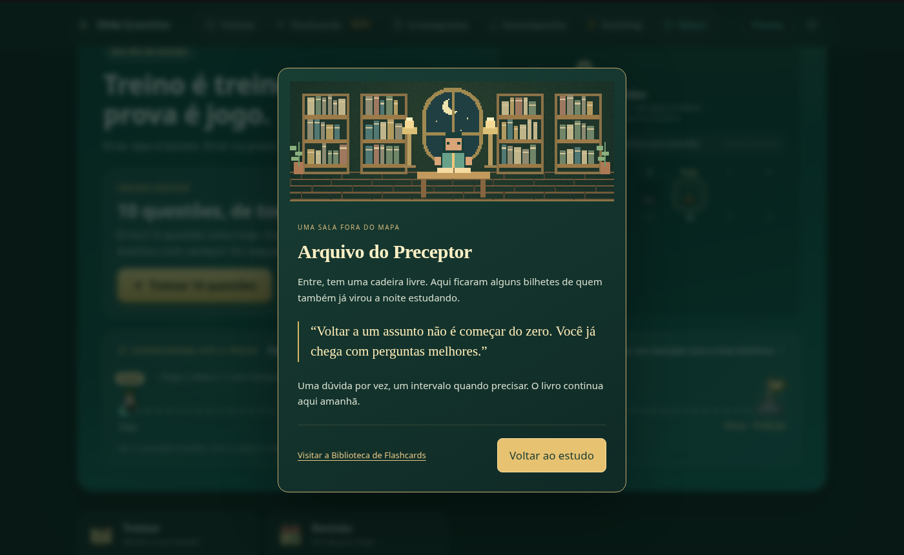
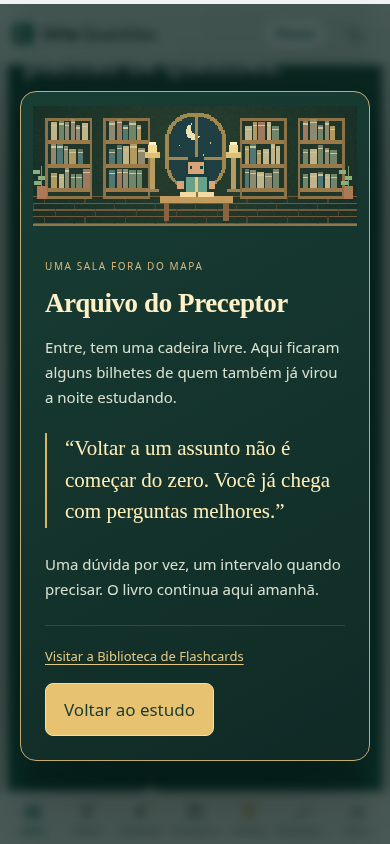
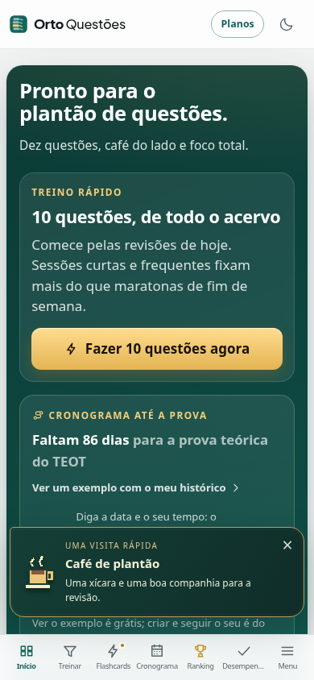

# Easter eggs e pequenos encontros — 16/10/2026

Implementados sobre `origin/claude/pdfs-questoes-tp64dr`, base `b1521885`, no worktree
`/workspace/ortoquestoes-eventos-20261016`, branch `codex/easter-eggs-eventos-20261016`.
Entrega: [PR #326](https://github.com/talesrobertosn/ortoquestoes/pull/326), implementação `0724d252911618445c74f520d0d827167a616912`.
Tales autorizou implementar e publicar em 16/10. O roteiro original está em
[prompts/easter-eggs-e-eventos.md](prompts/easter-eggs-e-eventos.md).

**Decisão posterior que prevalece:** podem aparecer durante uma questão comum ainda
sem resposta. Continuam bloqueados em Simulado Nacional, teste/prova do cronograma e
qualquer sessão com cronômetro. A sessão pendente de prova também bloqueia visitas no
resto do site até ser encerrada. Não há SQL, Edge Function ou escrita no servidor.

## Apresentação e frequência

**Limite que prevalece (Tales, 16/10/2026): no máximo uma surpresa por hora neste navegador,**
somando todas (sorteio, datas especiais, marcos, selo, recorde e o "Virou reflexo" do duplo clique,
que também acontece sem querer ao selecionar texto). A marca de tempo é única por navegador
(`oq:eventos:ultima-aparicao:v1`, em `memoria.ts`), vale para todas as contas do aparelho e para
todas as abas; fica fora de `estado/armazenamento` porque aquele é por conta, sincronizado e limpo
ao sair. Regra pura em `regras.ts` (`INTERVALO_EVENTOS` = 60 min, `liberadoPeloRelogio`).
Exceção deliberada: os gestos feitos de propósito para achar o segredo (cinco toques na logo,
código no teclado, carinho no gato) sempre respondem, com dez segundos entre eles, e também contam
como aparição (a próxima visita automática espera a hora inteira).

- Aviso no canto, sem som, sem capturar foco, some em sete segundos (convite para o Arquivo: dez),
  com um fio dourado que mostra o tempo restante e saída suave. A sala só abre por ação da pessoa.
- Visitas automáticas: esperar 90 segundos desde a montagem do módulo; tentativa a cada 30 segundos,
  probabilidade de 18%, e só depois do limite de uma hora. Uma aparição de cada tipo por dia de São Paulo.
- Datas pessoais e véspera têm prioridade quando o sorteio permite uma visita (sem furar o limite).
- Fila de marcos pessoais e selo só usa respostas locais feitas naquela aba; sincronização da nuvem
  não gera festa. A fila espera o limite de uma hora. O estado temporário some ao recarregar.
- Aba escondida remove a visita. Não há fila de sorteios acumulados ao voltar.
- Administração, conta/cadastro, cobrança, termos e suporte não recebem visitas. O combate tem sua
  própria apresentação. Na Biblioteca, só há o encontro com o gato, por interação.
- `prefers-reduced-motion: reduce` mantém o texto e remove todo movimento (confete, estrela, raio,
  poeira, fio do tempo, choque da logo).

### Visual (refeito em 16/10/2026)

Linguagem HD-2D do site: cada visita é um cartão com os tokens do tema (claro e escuro) e um pequeno
palco noturno de verdete onde o sprite (pixel art 32x32 a 2x, `scripts/eventos/gerar.py`, mesmo motor
dos ícones da página inicial) flutua sobre um halo de luz que respira, poeira de luz e sombra no chão.
Efeitos: confete em pixels, estrela cadente com cintilas, raio elétrico no topo do cartão (Tinel).
Logo: toques 2 a 4 acendem uma elipse de "agulhadas" douradas cada vez mais forte; no quinto, clarão,
três arcos elétricos que contornam a marca, faíscas e um tremor amortecido (âmbar no tema claro).
Arquivo do Preceptor: cena em pixel art com luar, candeeiros e vela acesos por luz suave, poeira no
ar, bilhete de papel com fita, botões dourados; foco inicial em "Voltar ao estudo".

Parâmetros só no Vite DEV, depois do hash: `?encontro=cafe|festa|estrela|tinel|selo|bolo|gato|arquivo`
(cartões), `?encontro=sala` (abre o Arquivo) e `?encontro=choque` (choque na logo).

## Como desligar

**Minha conta → Preferências → Leitura e aparência → Receber pequenas visitas e
surpresas durante o estudo.** Escolha local do aparelho, inclusive entre abas; não é
sincronizada. Desligar fecha visita/sala aberta e esconde o gato e o acesso local à sala.
A página 404 mantém sua ilustração estática de erro.

Preferência: `oq:eventos:ligados:v1`. Lembranças: `oq:eventos:lembrancas:v1:<id>`
(separadas por conta; visitante tem seu próprio espaço). Só armazenam datas de visitas,
marcos festejados, descoberta da sala e selo visual. Não entram nos documentos de
sincronização nem nas conquistas oficiais. Se o navegador recusar armazenamento,
funcionam na memória da aba. Não guardam nascimento, e-mail ou histórico médico.

## Easter eggs

| Surpresa | Gatilho e lugar | Frase/apresentação | Como conferir |
|---|---|---|---|
| Código ortopédico | ↑ ↑ ↓ ↓ ← → ← → B A, até 3 s entre teclas; fora de campos de texto | “Reflexos em dia”; convite para o Arquivo | Digitar com teclado em uma rota comum |
| Festas pessoais | Cruzar 1.000, 5.000 ou 10.000 questões diferentes respondidas pela pessoa | “questões na sua história”; confete local | Fixture de marcos e navegador com histórico sintético |
| Tinel na logo | Cinco cliques/toques na marca, menos de 900 ms entre eles | “Deu um formigamento por aqui”; contorno dourado discreto, sem tremor | Clicar cinco vezes na logo; não muda o link normal |
| Plantão da madrugada | Sorteio, 0h até antes de 5h em São Paulo | Três frases de companhia e cuidado; pode repetir após 18 min | Relógio falso no teste |
| R1 sem dormir | Mesmo período, visita separada e rara | “Se o plantão foi puxado, uma pausa pode ser a melhor revisão de agora.” | Relógio falso no teste |
| Dia do Ortopedista | 19 de setembro | Abraço a quem cuida, ensina e segue aprendendo | Relógio falso no teste |
| Véspera do TEOT | Um dia antes da data compartilhada com o cronograma | Documentos separados, revisão leve e descanso | `src/dados/calendarioProvas.ts`; teste da virada do dia |
| Arquivo do Preceptor | Convite descoberto pelo código ou Tinel; confirmação explícita | Sala nativa com bilhete de incentivo e saída para o estudo | Código real + entrar; Esc fecha, foco retorna |
| Gato da Biblioteca | Botão de carinho junto ao título da Biblioteca de Flashcards | Visita de cinco segundos do “bibliotecário de quatro patas” | Mouse, toque ou Enter no botão; não responde flashcard |
| Martelo de reflexo | Duplo clique em negrito/título de classificação no comentário ou Resumão | “Virou reflexo”; martelinho nativo | Texto com classificação, Sillence, Schatzker, Salter, Garden, Neer ou AO/OTA |
| Console | Uma vez por aba, se preferência ligada | “Plantão do navegador… Bom estudo!” | Console do navegador; sem dados pessoais |
| 404 | Rota inexistente | “Fratura no caminho”; trajeto interrompido com talas em SVG próprio | `#/uma-trilha-perdida` |
| Mão de cirurgião | Sete respostas corretas consecutivas observadas nesta aba; erro reinicia | Selo visual local; exibido na sala descoberta e em Preferências | Histórico sintético; conferir que ranking/conquistas não mudam |

A 404 usa uma **fratura do trajeto**, sem anatomia decorativa, respeitando a regra
permanente de cenários sem ossos, músculos ou vasos. O gato é uma visita própria,
sem mudar tiras de VFX ou sprites de adversários existentes.

## Eventos sorteados

| Evento | Quando pode entrar no sorteio | Texto/efeito |
|---|---|---|
| Café de plantão | Rota comum, regras de frequência | Xícara e companhia de colega |
| Bilhete na prancheta | Idem | Entender a dúvida com calma |
| Visita do mascote | Idem | Mensageiro só de passagem |
| Estrela cadente | Idem | Rastro breve; estático com movimento reduzido |
| Sexta à noite | Sexta, a partir de 18h | Café e um respiro depois da revisão |
| Confete do acaso | Rota comum | Uma pequena festa sem motivo, sem prêmio |
| Frases por hora | Manhã, tarde ou noite | Café de manhã, água/ombros à tarde, revisão tranquila à noite |
| Aniversário da pessoa | Mesmo dia/mês do `user_metadata.nascimento` existente | Parabéns e bolo nativo; não mostra idade ou data |
| Aniversário da conta | Mesmo dia/mês de `user.created_at` em São Paulo, após um ano | Celebra a companhia; não faz consulta nova |
| Recorde pessoal | Hoje supera o melhor dia anterior do histórico disponível (pelo menos dez respostas), após resposta local | Texto deixa claro o alcance do histórico deste aparelho |
| Datas especiais | 19/9, véspera do TEOT, 31/12 e 1/1 | Mensagem breve, sem promoção |
| Biscoito da sorte | Rota comum | Quatro bilhetes sobre revisão, pausa e perguntas |
| Fim de semana | Sábado ou domingo | Personagem por cinco segundos: “Sábado, 15h, e você aqui” |
| Madrugada | 0h–5h | Companhia com cuidado e descanso, frases variadas |

Nascimento em 29/2 é celebrado em 29/2 nos anos bissextos; não inventamos outra data.
O recorde usa o histórico disponível, que limita tentativas antigas por questão;
não promete um recorde absoluto de toda a vida. Nenhum contador é regravado.

## Arquitetura e arte

- `src/eventos/regras.ts`: funções puras (relógio, rota, estado, preferência, sorteio).
- `Encontros.tsx`: componente lazy, agenda, gestos, observação somente de leitura,
  diálogo nativo e avisos. Carregado 2,5 s após a primeira pintura; CSS também separado.
- `preferencias.ts`, `memoria.ts`: armazenamento local isolado, sem RPC.
- `PreferenciaEncontros.tsx`: opção em Minha conta e lembranças descobertas.
- `GatoBiblioteca.tsx`: interação acessível pelo teclado, sem alterar fila, som ou pontuação.
- `scripts/eventos/gerar.py`: Pillow e semente fixa; doze ícones de 40×44 e uma sala
  de 240×88 em `public/eventos/`. Estantes, mesa, janela, candeeiros e personagem
  desenhados por código. Sem download ou geração de imagens externa.
- A data TEOT já existente foi apenas extraída de PlanoEstudo para um módulo comum;
  nenhuma mudança no cronograma. O evento de plano usa a data TEOT salva quando disponível.
- Todos os caminhos de arte usam `recurso()`. Não criamos imagens em variáveis CSS.

## Testar e continuar

```sh
python3 scripts/eventos/gerar.py
npx tsc --noEmit
npm test
npm run build
git diff --check
VITE_SUPABASE_URL=sem npx vite --host 127.0.0.1 --port 5203
# Em outro terminal:
node fixtures/capturar_eventos.mjs
```

`fixtures/testar_eventos.mjs` está no `npm test`: sábado/domingo/sexta, virada de
São Paulo, madrugada e repetição, aniversário e ano bissexto, conta, véspera, preferência,
aba invisível, diálogo, provas/teste/cronômetro, questão aberta, cooldown, sorteio,
redução de movimento, código, marcos e armazenamento separado por conta, inclusive sem disco.

`fixtures/capturar_eventos.mjs`: Chromium local `/usr/bin/chromium`, computador
1400×860 e celular 390×844. Café, código real, sala/Esc, Tinel, desligar/ligar,
iniciar simulado remove visita, código bloqueado durante simulado, questão comum
com movimento reduzido, gato e 404. Dados sintéticos apenas em navegador isolado.

Parâmetros **só no Vite DEV** `?encontro=cafe|festa|arquivo|gato`, depois do hash,
ajudam a capturar. Não existem como gatilho no build de produção; ainda respeitam
preferência, prova e diálogo. A produção mantém apenas os gestos reais e sorteio.

Capturas originais:
`/tmp/claude-0/-home-user-ortoquestoes/470d052f-b947-5213-a54a-486d1d75caf6/scratchpad/capturas-eventos/`.
Uma seleção fica em [eventos/capturas](eventos/capturas/) para a passagem entre agentes.

## Limites deliberados

- Selo e sala são locais, sem vantagem, ranking, ouro, carga ou conquista oficial.
- Sem servidor novo e sem preferência sincronizada: não havia campo existente
  compatível com essa escolha. Nada para colar no Supabase.
- Não alteramos conteúdo médico, gabaritos, planos, limites ou dados existentes.
- A sala contém bilhetes de estudo; não acrescenta questões ou recomendações clínicas.

## Resultado da validação local

- `npx tsc --noEmit`, `npm test`, `npm run build` (inclui `tsc -b`) e
  `git diff --check`: aprovados em 16/10/2026.
- Capturas e interações em Chromium: aprovadas nos dois tamanhos; zero erros de
  página. Incluem marcos com histórico sintético, selo local e verificação de que
  festas não regravam respostas nem criam conquista oficial.
- Orçamento medido pela fixture (gzip nível 9): entrada JS **49,7 KB**, CSS global
  **29,6 KB**, inicial completo **152,8 KB**; abaixo dos tetos existentes, sem aumentá-los.
- O build de produção remove o parâmetro de captura `encontro`; os gestos reais
  continuam funcionando e sujeitos às regras de preferência/prova.




