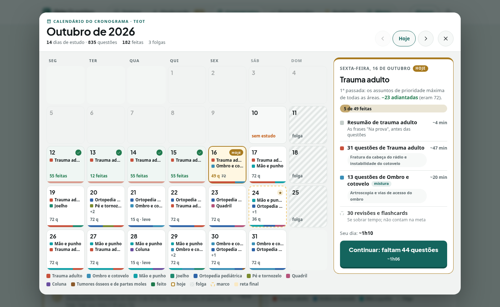
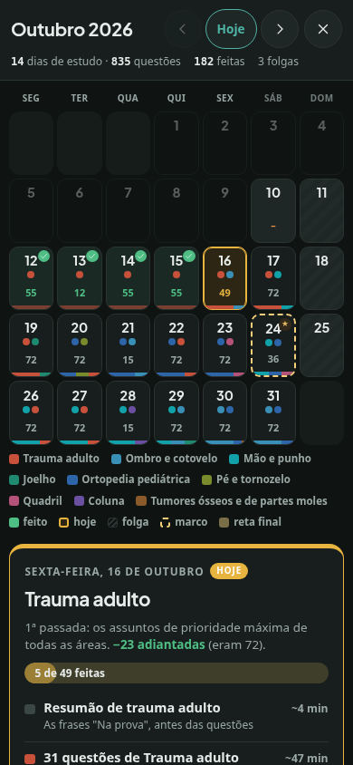
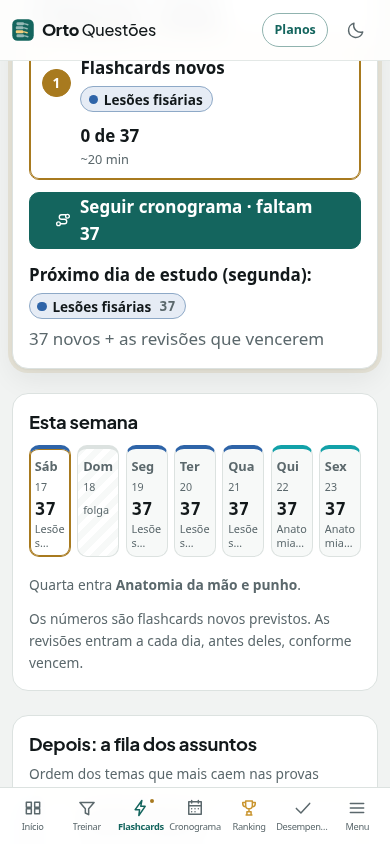

# Revisão dos calendários — 16/10/2026

Entrega: [PR #327](https://github.com/talesrobertosn/ortoquestoes/pull/327), implementação `7fe7b7c1f3a2722a5c50870e712d23559a679397`.

Tales pediu continuidade, publicação a cada bloco concluído e atenção especial aos
calendários. Este bloco parte do merge `e363c582` (eventos publicados no PR #326),
branch `codex/calendarios-revisao-20261016`, worktree
`/workspace/ortoquestoes-eventos-20261016`.

## Questões: calendário mensal

- **Datas civis:** a prova vem da data já salva no plano. Somar 24 horas à véspera
  podia cair no dia errado em aparelhos de fusos com mudança de horário de verão.
  O calendário, o trilho, a linha do tempo e a exportação agora usam a mesma data.
- **Navegação:** mudar de mês leva a seleção e o detalhe juntos. Janeiro com dia 31
  vai para 28 de fevereiro (29 no ano bissexto), sem pular março. A seleção respeita
  a criação do plano e a prova.
- **Plano encerrado:** abre no mês da prova, com o dia selecionado. O botão passa
  de “Hoje” para “Dia da prova”; não fica preso num mês posterior vazio.
- **Hoje:** contorno e indicação acessível `aria-current="date"` também na folga,
  reta final, véspera e prova. Ao atravessar meia-noite, acompanha a data de São
  Paulo sem recarregar; se a pessoa estiver consultando outro dia, preserva a escolha.
- **Histórico:** dias da reta final já vividos mostram o que foi feito, em vez de
  aparecerem como planejamento futuro. O resumo do mês inclui essas respostas.
- **Teclado:** Tab e Shift+Tab ficam no calendário; Esc fecha e devolve o foco ao
  botão que abriu. Atualizações do plano não arrancam o foco do dia selecionado.

## Flashcards: hoje, semana e previsão

O cálculo estava memorizado somente por plano e registros: uma aba deixada aberta
podia continuar no dia anterior até alguém responder ou alterar o plano.

- `usarDiaAtual()` agora invalida o cálculo à meia-noite de São Paulo e ao voltar
  para a aba. Hoje, semana, vencimentos e previsão se atualizam juntos.
- Mudança de plano/registros em outra aba passa a atualizar a tela pelo evento
  `storage`, filtrado pela chave do perfil atual.
- A troca de conta invalida as leituras memorizadas. Não se reaproveita o plano ou
  progresso da conta anterior.
- Um dia de folga sem estudo aparece como folga, em vez de uma meta marcada como feita.
- A data sugerida da prova usa `DATA_TEOT`, compartilhada com o cronograma de
  questões e os eventos de véspera, sem duplicar o literal em páginas diferentes.

Não mudamos a fila, as regras de revisão, o ritmo, os dias escolhidos ou qualquer
registro salvo. Só a apresentação recalcula com os dados atuais.

## Exportação para o calendário do celular

`src/dados/calendarioIcs.ts` separa o gerador puro da apresentação:

- prova e prova extra preservam a data civil, inclusive em fusos com horário de verão;
- linhas seguem o limite de 75 octetos do formato iCalendar e não partem caracteres
  UTF-8; vírgulas, ponto e vírgula, barras e quebras de linha são escapados;
- hora final à meia-noite passa corretamente para o dia seguinte;
- inclui os marcos futuros já existentes no plano: revisão forte, modo prova e
  véspera. Não recria lembretes de transições passadas;
- prova e prova extra continuam sem alarme de estudo. Os compromissos de estudo
  mantêm o horário escolhido. A exportação não grava nem altera o plano.

## Testes e capturas

`fixtures/testar_calendarios.mjs` entra no `npm test`. Cobre quatro fusos (São Paulo,
UTC, Los Angeles e Auckland), mês encerrado, fevereiro e ano bissexto, limite da prova,
histórico na reta final, data civil da prova, marcos, acentos, escape, dobra de linhas,
alarme, meia-noite e ausência de mutação. As provas usadas nos casos de teste são
**sintéticas**, não datas oficiais de outras provas.

`fixtures/testar_calendarios_navegador.mjs` roda com o Vite DEV sem Supabase:

```sh
VITE_SUPABASE_URL=sem npx vite --host 127.0.0.1 --port 5203
node fixtures/testar_calendarios_navegador.mjs
```

Chromium em 1400×860 e 390×844: troca de mês/detalhe, seleção visível, foco preso,
Esc/foco de volta, aba atravessando meia-noite, hoje na reta final/folga, prova em
fuso com horário de verão, plano encerrado e atualização de Flashcards por outra
aba. Nenhuma conta real ou escrita no servidor. Capturas originais em
`/tmp/capturas-calendarios-16-10/`.

O capturador anterior `fixtures/capturar_calendario.mjs` também foi ajustado para
aceitar `CHROMIUM`, usar o navegador instalado neste ambiente e devolver erro de
processo quando encontra falhas; não apenas imprimir o erro com saída de sucesso.

Validação obrigatória: `npx tsc --noEmit`, `npm test`, `npm run build` e
`git diff --check`. A apresentação foi conferida nas capturas antes da entrega.

## Continuidade

Sem SQL, Edge Functions, mudanças médicas, planos comerciais ou limites. Preferências,
metas e histórico existentes são apenas lidos. O estado da publicação fica no PR
referenciado no registro de entrega. Não há dependência externa para este bloco.

## Evidência local

Suíte completa, TypeScript, build e diff aprovados. Orçamento mantido: entrada
49,7 KB gzip (nível 9), CSS 29,6 KB, inicial total 152,8 KB. Teste no navegador
aprovado com zero erros de página. O rótulo do atalho TEOT/TEPOT também deriva da
data compartilhada, evitando texto de ano/data separado do valor do formulário.





A revisão final também aplica à mensagem do console o mesmo bloqueio de provas,
preferência e diálogos que já protege as visitas visuais.
